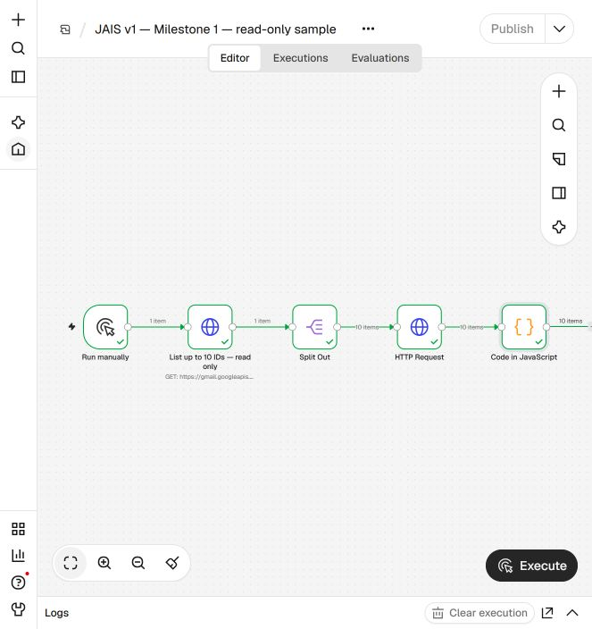
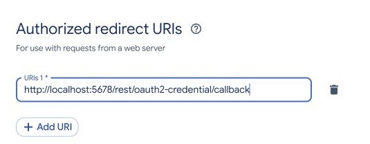
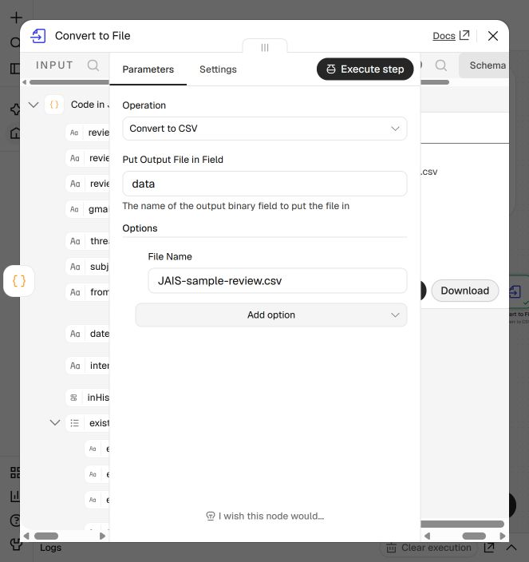

# JAIS v1: project walkthrough and interview practice

## How to use this guide

Read the short project story aloud first. Then practice the questions in your own words. The answers describe the prototype and the assisted case study accurately; do not claim that future features are already automated, or that you personally wrote a component that was built with assistance. You can explain that you defined requirements, made decisions, tested and reviewed the results, and used an AI assistant as a development collaborator.

## 1. A 30-second project explanation

"I built a local prototype to help review job-application emails and prepare evidence of my search. I used Docker to run n8n locally and Google OAuth with read-only Gmail access. A workflow lists message IDs, retrieves the messages, and exports text and possible outcome signals for human review. For the case study, I checked uncertain cases, captured actual Gmail screenshots, and assembled them into a PDF. Automatic label assignment, monitoring, and PDF capture are the next steps, not completed features."

## 2. A two-minute answer

"The problem was that application decisions were scattered across Gmail and I wanted a clear record of job-search activity. My design goal was to preserve the original emails, avoid a separate application database, and require human review when an outcome was uncertain.

I ran n8n in Docker with its web port bound to localhost and used a persistent volume so that workflows and credentials survived a container restart. I created a Google Cloud project, enabled Gmail API, configured an OAuth consent screen and connected a read-only Google OAuth credential. The owner signed in and approved access directly with Google.

The manual workflow called Gmail's message-list endpoint, followed page tokens, split the list into individual message IDs, fetched message bodies at a controlled rate and prepared a CSV. The code extracted text from MIME parts and generated keyword hints. Hints were only candidates, so the actual decision needed review of sender, subject and context. We reconciled ID counts and inspected warnings instead of equating a successful run with complete coverage.

The evidence PDF was assembled separately from genuine screenshots of emails opened in Gmail. The browser capture was not generated by the Gmail API and the PDF did not automatically certify the messages or add a signature. In one mailbox the first screening missed two rejection emails; that exposed the risk of relying on candidate searches, so the workflow was reviewed again at message level and the PDF corrected. The code and sample screenshots in the public project contain no private mailbox data."

## 3. The system in five blocks

1. Docker Desktop runs the local n8n service. The Compose file exposes n8n on localhost and mounts a named volume.
2. Google Cloud holds the API configuration and OAuth client. The user consents to Gmail read-only access; n8n stores the credential in its own local data.
3. The n8n workflow lists Gmail message IDs, follows pagination, fetches full messages and transforms content into a CSV.
4. A person reviews message text and originals, resolves ambiguity, and determines which messages belong in evidence. This review was assisted by an AI collaborator; it was not an autonomous production classifier.
5. A signed-in browser provides actual Gmail screenshots. A separate local process places the approved screenshots into a PDF and checks the number of pages and message IDs.

## 4. Step-by-step: what happened

### Step 1 - Define the goal and boundary

The starting request was to find job-application confirmations, interview messages and rejections, then create a PDF containing genuine screenshots of rejected applications. The original historical boundary was 1 October 2025 in the Europe/Dublin time zone; in a later second-account review, the user chose all dates. Sent, inbox categories, Spam and Trash were considered in scope where available. The user decided ambiguous cases individually.

### Step 2 - Run n8n locally

Docker Compose started a pinned n8n image with a named volume, a local-only web port, and reduced execution data retention. The user opened the editor at localhost and created an owner account. A named volume survives ordinary container replacement, but it must be backed up securely; deleting it can remove workflows and the key needed to decrypt credentials.

### Step 3 - Connect Gmail

A Google Cloud project enabled the Gmail API. We configured an OAuth consent screen, added the relevant Gmail account as a test user, created a Web application client and registered n8n's exact redirect URI. The user signed in to Google and authorized read-only access. A separate credential was configured for the second Gmail account and selected in both HTTP Request nodes. Never put passwords or OAuth secrets in the repository.

### Step 4 - Validate a small sample

A manual run was limited to 10 messages. Because the HTTP node paginates, both page size and maximum pages mattered. We verified the selected credential and inspected node results before expanding the scan. One attempted sample initially returned more than intended because the page-limit field had not saved; the run was stopped, the value was corrected and the 10-message result was verified.

### Step 5 - Retrieve and prepare review data

The list endpoint returned message IDs and thread IDs. `nextPageToken` was used to retrieve subsequent pages. Split Out converted a list response into one item per ID. A second GET retrieved each message in `format=full`; a batch interval reduced quota pressure. The code node extracted readable MIME text, recorded warnings, and generated candidate signals for rejection, interview and confirmation. Convert to File wrote a CSV for review. No AI model was configured inside the n8n workflow.

### Step 6 - Review decisions and investigate errors

A human-reviewed process distinguished confirmations, interview invitations, rejections, unrelated messages and uncertain cases. A job alert, an assessment, a conditional statement or a role that closed before a review need not mean rejection. The user chose how to handle specific ambiguous messages, including allowing a notice that an application could not be sent; that notice must be described accurately.

The first-account export contained 1,020 unique IDs from the chosen start date. A later audit corrected an earlier PDF that omitted two Pfizer rejection messages. The corrected first-account PDF contained 62 rejection messages over 66 pages. This is a case-study result, not a benchmark or proof that the system is infallible. Some repeated text was reused during review and attachment-only outcomes remained a limitation.

The second-account inventory returned 178 unique IDs; an all-date ID inventory matched the previously fetched set at the snapshot. A second review examined exported records individually. Sent and Spam appeared empty at that time, while Trash records existed. Its later PDF contained 41 messages across 45 pages, including a user-approved Careerjet notice saying the application could not be sent. Some HTML was approximately converted and image/inline attachments were not all separately interpreted.

### Step 7 - Capture and reconcile evidence

For selected messages we opened Gmail in the browser, checked the account and message, and captured the actual interface. Some branded messages required a header view plus a second screenshot showing the decision. In grouped conversations, separate messages required separate attention. A local manifest linked screenshots to message IDs and recorded file hashes. The PDF was rendered for visual inspection. Screenshots and source emails remained private and are not part of this repository.

### Step 8 - Be precise about unfinished work

The Gmail labels Rejections, Confirmations and Interviews were created manually. They were not automatically assigned by the workflow. There is no scheduled monitor, no completed human-review UI, and no shipped automated Gmail screenshot or PDF-generation workflow. Those are future engineering steps requiring testing, permissions and explicit consent.

## 5. Interview questions and suggested answers

### Why use n8n instead of writing everything from scratch?

"n8n made it easy to build and inspect a sequence of API calls visually. A custom code node handled MIME extraction and candidate hints. I chose it for prototyping and visibility, while recognizing that a production system would need stronger testing, retries, resumability and a review interface."

### How does the workflow know which Google account to use?

"The Gmail endpoint uses `users/me`, which means the account that granted the selected OAuth credential. The first list node and the message-fetch node must both use the intended account's credential. I tested the connection before running a full scan."

### What is OAuth and why not use a Gmail password?

"OAuth lets the user authorize a scoped application through Google. The application receives tokens for the approved access; it does not need the user's Gmail password. I used `gmail.readonly` for retrieval. The owner signs in and consents directly with Google, and the client secret and tokens stay out of GitHub."

### How is n8n's own storage different from an application database?

"I avoided a separate database of job applications. Gmail remains the source of original messages. n8n still uses internal persistent storage for workflows, settings and credentials, and the local review CSV and capture manifest are files that contain sensitive data."

### How did you avoid missing messages due to pagination?

"I followed `nextPageToken` until the API indicated there was no next page, then split the returned arrays into message records. I compared the list of IDs against fetched records and CSV rows. Counts alone are not proof; ID-set comparison and a fixed snapshot are stronger. Deleted items, new arrivals, parsing errors and inaccessible content can still limit completeness."

### Why were there quota errors and what did you do?

"The Gmail API rejected a run for exceeding its query-cost limit. I stopped treating that execution as complete, increased the interval between message requests, retried, and checked the output counts. A production version should use backoff, resumable checkpoints, monitoring and quota-aware rate control."

### How did you classify emails?

"The prototype generates regex-based hints, not authoritative decisions. I reviewed sender, subject and message context, with an AI assistant helping analyze records. For ambiguous messages the user decided inclusion. Keyword hits alone can misread a quoted rejection, a job alert or conditional wording."

### What went wrong with the first PDF?

"An earlier candidate-based screening omitted two Pfizer rejection emails. We corrected the process by reviewing the exported message inventory, reconciling IDs to screenshots and regenerating the PDF. The lesson was to test completeness, communicate uncertainty and distinguish a first draft from a verified deliverable."

### Are there exactly 41 rejected applications in the second case?

"The PDF has 41 email messages, not necessarily 41 distinct applications or 41 formal employer rejections. Two are near-duplicate notices for the same Ministry Brands role, and the user specifically included one Careerjet message saying the application could not be sent. Counts must describe what they actually measure."

### Did the system automatically label emails and monitor future mail?

"No. We created Gmail labels manually, but the read-only workflow did not apply them. It also does not run on a schedule. Those are future steps and would need a modified workflow, an approval process and appropriate Gmail permissions."

### Why capture the Gmail interface instead of rendering API HTML?

"The requested evidence format was a screenshot of the real email as displayed by Gmail. The API can supply email content, but an HTML rendering produced by my own code is not a Gmail screenshot. The browser must be separately signed in, and images need checks for correct message, sender, date, readability and thread context."

### Are screenshots, hashes or a PDF proof of authenticity?

"They can help document what was displayed, and hashes can detect subsequent changes to the saved files. They do not independently prove email origin or guarantee acceptance by an authority. The original messages and their headers remain important, and the recipient decides its evidence requirements."

### What about privacy and security?

"The workflow asks for read-only Gmail access, uses localhost and keeps OAuth credentials in the user's n8n instance. CSV exports may contain unrelated confidential mail and temporary codes, so they and the evidence screenshots stay private. Repository workflow exports must be stripped of credentials, pinned data, execution data and personal identifiers before publishing."

### How would you improve it for real users?

"I'd first build tests with synthetic messages and measure precision and recall. Then I'd add resumable paginated scans, robust MIME and attachment handling, a human-review queue, message-level idempotent labels with explicit permission, rate-limit backoff, an overlap-based scheduled monitor, and an auditable screenshot/PDF pipeline. I'd assess Google restricted-scope verification and security requirements before sharing one OAuth app with many users."

## 6. Practice speaking with confidence

Use the pattern: problem, choice, evidence, limitation. Pause after each sentence. If asked about a detail you do not remember, say, "I would check the implementation rather than guess." Use the 30-second explanation, then add the OAuth, pagination or review detail that answers the question. Practice explaining the first PDF omission openly: the correction is a useful engineering lesson.

## 7. Key terms

OAuth: a way for the owner to grant scoped access through Google. Scope: what that access permits. MIME: the structure of email content and attachments. Pagination: retrieving a large result in pages. Idempotent: repeating an operation does not create unwanted duplicates. Rate limit: a provider's cap on requests or quota units. Localhost: a network address for the same computer. Hash: a fingerprint useful for detecting file changes. Human review: a person verifies an uncertain decision before action.

## 8. References

- n8n Docker: https://docs.n8n.io/hosting/installation/docker/
- Gmail list endpoint: https://developers.google.com/workspace/gmail/api/reference/rest/v1/users.messages/list
- Google OAuth token behavior: https://developers.google.com/identity/protocols/oauth2
- Google restricted-scope verification: https://developers.google.com/identity/protocols/oauth2/production-readiness/restricted-scope-verification
