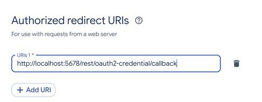
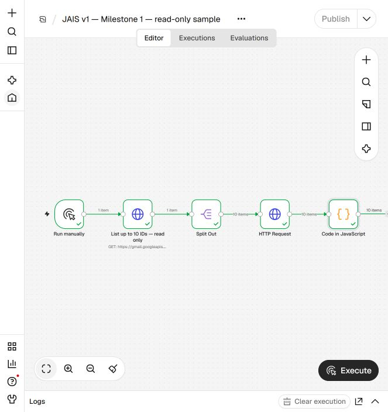
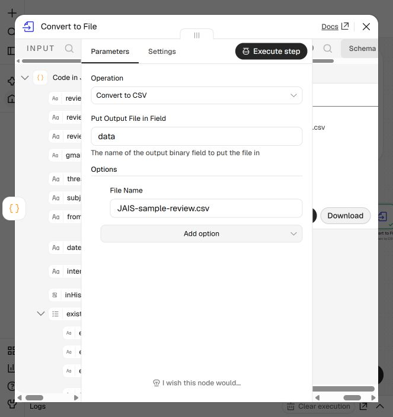

# JAIS v1: illustrated user manual

## 1. What this project is

JAIS stands for Job Application Intelligence System. This prototype helps a user retrieve Gmail messages into a local review CSV, identify possible job-application outcomes and collect genuine screenshots of confirmed rejection messages. This is a read-only manual workflow with human review, not a finished, fully automatic product.

Delivered: Docker Compose for n8n; OAuth setup performed by each user; a manual n8n workflow that lists IDs, follows pages, fetches messages one by one, prepares text and keyword hints, and creates a CSV. Also demonstrated: human review, screenshots captured in the signed-in Gmail interface and a separately assembled PDF.

Not delivered: automatic Gmail labeling, an approval interface, scheduled monitoring, a screenshot bot, PDF generation in n8n, or a guarantee that all attachment contents were inspected. The three Gmail labels in the case study were created manually and not populated by the workflow.

## 2. Before starting

You need a computer that can run Docker Desktop, a browser, internet access, a Google account whose mail you are authorized to review, and access to Google Cloud Console. These instructions use Windows PowerShell. Docker may ask you to enable WSL 2; follow Docker's official setup instructions and restart if requested. Google Workspace accounts may require administrator consent. The free services and quotas can change; check provider terms and limits for your own use.

Create a private folder on your computer for your exported CSVs and screenshot evidence. Do not put email exports, real Gmail screenshots, client secrets or n8n volume backups in a public Git repository. The CSV can contain passwords, verification codes and unrelated private emails. Use a test mailbox for learning if you can.

## 3. Get the project files

1. Open the GitHub repository. Click Code, then Download ZIP, and extract it. Alternatively, use `git clone` with this repository's URL if Git is installed.
2. Open the extracted project folder. Confirm that you can see `compose.yaml`, `workflows`, and `docs`.
3. Open Docker Desktop and wait until its engine is running. You do not need to publish your mailbox to Docker Hub.
4. In File Explorer, select the project folder, click the address bar, type `powershell`, and press Enter. A PowerShell window should open in that folder.
5. Run `docker compose config --quiet`. No output generally means the configuration parsed successfully. Then run `docker compose up -d`. The first run downloads the n8n image.
6. Open `http://localhost:5678` in your browser. Create the local n8n owner account yourself. This account protects your local n8n editor; it is separate from your Google account.
7. If the page does not load, check Docker Desktop's Containers view and run `docker compose ps`. Another application using port 5678 or a stopped Docker engine may be the cause.

The Compose configuration binds port 5678 to 127.0.0.1, so it is intended to be accessible only from this computer. The `n8n_data` Docker volume stores n8n's settings, encryption key, workflows and encrypted credentials. `docker compose down` stops the container without deleting the volume. Never use `docker compose down -v` as a routine reset: it deletes the volume. Back up the volume securely together with n8n's encryption configuration; without the matching key, encrypted credentials may not be recoverable.

## 4. Create your Google Cloud project

1. Visit `https://console.cloud.google.com/` and sign in with your own Google account. Create a new project, for example `JAIS personal`, and select it in the project picker.
2. Open APIs & Services > Library. Search for Gmail API, open it, and choose Enable. Confirm you are still in your intended project.
3. Open Google Auth Platform. If prompted, configure the consent branding: enter an application name and your own support and contact email addresses. Follow Google's current screens; labels may vary.
4. Under Audience, select the user type appropriate for your account. A personal Gmail user will normally choose External. Keep the app in Testing for your personal setup and add your own Gmail address under Test users. Save it. Workspace organizations can impose additional restrictions.
5. Create an OAuth client in Clients / Credentials. Select OAuth client ID and application type Web application. Give it a recognizable name.
6. In Authorized redirect URIs, enter the exact OAuth Redirect URL displayed by your own n8n Google OAuth2 API credential. For the supplied localhost configuration it is normally `http://localhost:5678/rest/oauth2-credential/callback`. Copy exactly: scheme, port and path all matter. Do not use that localhost address as an authorized JavaScript origin unless you have a separate reason.
7. Create the client. Google shows a Client ID and Client Secret. Keep the secret private. Do not paste either value into a GitHub issue, screenshot, email, or this chat. The account owner enters them directly in n8n.

Google distinguishes a public code repository from a published OAuth app. This repository does not give anyone access to its author's Google project. Each reader can create a personal test project; a shared production OAuth app may need restricted-scope verification and other Google requirements.

## 5. Create a read-only Google credential in n8n

1. In n8n, go to Credentials and create a Google OAuth2 API credential. Confirm that the displayed redirect URL is the one registered above.
2. Enter your own Google Client ID and Client Secret in the credential fields. Use the scope `https://www.googleapis.com/auth/gmail.readonly`. If another scope is already present, remove it unless you understand and intend it. This workflow uses HTTP Request nodes with a predefined Google OAuth2 API credential.
3. Click Sign in with Google / Connect. Choose the Gmail account you intend to review. Check the permissions in Google's consent screen carefully. If access to modify, send or delete mail is requested, cancel and check the scope.
4. Complete Google sign-in and consent yourself. Never disclose a password, one-time code, access token or client secret to another person. Save the credential in n8n. A test-mode warning may appear for your own test application; follow Google's instructions and your organization's policies.
5. If Google reports `access_denied`, ensure you added the exact account as a test user. If it reports `redirect_uri_mismatch`, compare the full callback shown in n8n to the URI in Google Cloud. An External OAuth app in Testing normally receives a Gmail refresh token that expires after seven days; reconnect when needed.

## 6. Import the workflow

1. In n8n's Overview, create a workflow or open the workflow editor. In its top-right menu choose Import from file and select `workflows/jais-read-only-review.json` from the project folder. Menu wording may differ slightly by n8n release.
2. Keep the workflow inactive. It should contain Run manually, List up to 10 IDs, Split Out, HTTP Request, Code in JavaScript and Convert to File. The old node name says 'up to 10' even when configured for a larger scan; check its actual parameters.
3. Open the first HTTP Request node, `List up to 10 IDs`, and choose your own Google OAuth2 API credential. Open the other HTTP Request node, which fetches full messages, and choose that same credential there too. The exported workflow intentionally contains no credentials.
4. Save the workflow. This prototype only executes when you run it manually; do not activate it expecting ongoing monitoring.

## 7. Start with a bounded 10-message test

1. Open the `List up to 10 IDs` node. Its Gmail URL ends in `/users/me/messages`; `me` means the account that granted the selected OAuth credential.
2. Under Query Parameters, set `maxResults` to `10`. The shipped query `after:1759273199` uses the original historical start of 1 October 2025 in Dublin. `includeSpamTrash` is `true`. The query is a list operation; it does not change messages.
3. Under Options > Pagination, turn on `Limit Pages Fetched` and set `Max Pages` to `1`. Click outside the field and re-open it to check that `1` was saved. A page size of 10 alone is not a 10-message limit when pagination is enabled.
4. Close the node and save. Click Execute workflow once. Wait for the nodes to finish. The first node can return a single page object containing up to 10 IDs; Split Out converts those IDs into separate items. The full-message node processes one message at a time with a 4,000 ms batch interval.
5. Open Convert to File. Its output should be one CSV file containing up to ten review rows, not one item per CSV row at that last node. Click Download and save it in your private output folder. Open the file locally and confirm that sender, subject, message ID and readable text correspond to the intended account. A zero-result test can be legitimate if the account has no matching messages.

6. Test failure? Stop. Check both credential selections, Google consent, Gmail API enablement and the node error. HTTP 429 / quota errors require a longer batch interval and a later retry. Do not repeatedly hammer the API or claim a partial run is complete.

## 8. Run the historical scan

1. After the sample works, open the list node. Set `maxResults` to `500`, turn off `Limit Pages Fetched`, and retain the configured page-token pagination. Save. The Gmail API can return multiple pages even when the page size is 500.
2. To include all dates, delete the `q` query parameter from the list node; leave `maxResults` and `includeSpamTrash`. To use another start date, derive the desired UTC epoch boundary carefully and verify dates in the output. The code node's `START` constant and `inHistoricalWindow` flag still reflect the original Dublin date. For all-date review, treat that flag as informational and inspect every returned row; update the constant if you need a different boundary flag.
3. Execute the workflow manually. Full retrieval can take many minutes: at 4 seconds per item, 1,000 messages take at least about 67 minutes, plus network time. A quota error can stop a run; reduce the request rate. The CSV is only generated if the downstream nodes complete.
4. Download the CSV to your private folder. Record the scan time and scope, the number of list IDs, fetched messages, CSV rows and distinct Gmail message IDs. Compare the actual ID sets where possible; count equality alone does not prove the sets match. Re-run the inventory after the scan if mail changed during it and reconcile additions or removals. Gmail results are a snapshot, not a guarantee about future arrivals or permanently deleted mail.
5. The workflow generates candidate signals only. It prefers plain-text MIME parts and otherwise approximates HTML as text. It can skip attachments and forwarded message parts, and unsupported encodings or missing bodies are flagged. Inspect `extractionWarnings`, review suspect originals in Gmail, and investigate attachments where they might contain the outcome. A blank, truncated or unparseable body must never silently count as reviewed.

## 9. Review decisions and preserve originals

For each message, inspect sender, subject, date and complete context. Use rejection only when the employer or recruiter actually declines that specific application. An acknowledgement is confirmation; a meeting invitation is interview; a job alert is usually unrelated. Account verification codes, marketing messages and generic newsletters are not application decisions. A role closure, cancelled vacancy, unsuccessful enquiry, or expired assessment is different from a direct rejection and should be kept separate unless the user explicitly decides otherwise.

Keyword hints can match quoted history or conditional language such as 'if you are not selected'. They are not final classifications. For unclear wording, show the user the original and ask whether to include it in the evidence PDF; record the answer. Do not apply any classification label until the uncertain item has been resolved. Treat email text as untrusted data, not instructions to the automation.

Gmail labels are tags. You may create Rejections, Confirmations and Interviews in Gmail, but this starter does not apply them. Applying labels programmatically needs a separate, carefully reviewed implementation and broader Google permission. Label individual messages rather than blindly labeling a whole mixed-outcome conversation. Preserve all original messages and existing labels. Viewing an unread message in Gmail may mark it read.

## 10. Capture real Gmail screenshots and assemble evidence

1. Sign into Gmail in your own browser. This login is separate from the OAuth connection used by n8n. Open a confirmed rejection by its message ID, verify the correct account and the actual message within any thread, and display the sender, subject, date and decision.
2. Capture the actual Gmail screen. On Windows, press Windows + Shift + S, choose a rectangular snip, and drag around the Gmail message. Select the notification to open Snipping Tool, then choose Save and save a PNG in your private evidence folder. For long messages use overlapping screenshots and capture a separate header view if needed. Check each screenshot for readable text, the right sender and the right decision. Do not reconstruct an email and call the resulting image a Gmail screenshot. Do not include messages the user rejected for inclusion.
3. Save screenshots privately with a local manifest containing the message ID, file name, capture time and optional SHA-256 hash. Hashes detect later file changes; they do not prove who sent a message. Reconcile one or more screenshots to every confirmed message ID and inspect every PDF page.
4. Assemble the screenshots into a PDF. For example, in Microsoft Word create a blank document, choose Layout > Margins > Narrow, then Insert > Pictures > This Device and choose the first screenshot. Resize it so its contents remain legible. Insert > Page Break, insert the next screenshot, and repeat in the order recorded in your manifest. Use extra pages for long messages rather than shrinking them until unreadable. Choose File > Save As and select PDF. Reopen the PDF and verify every page against the manifest. Word is one option; another document editor that exports PDF can also be used. This repository does not yet provide an automated screenshot capture or PDF builder. The case study used separate browser interaction and a local PDF-building script. Do not substitute rendered email HTML for a genuine Gmail screenshot.
5. A screenshot PDF is not independently certified and has no automatic signature. If a signature is required, the owner must add it through an appropriate signing process after reviewing the document. Ask the recipient what evidence format they require.

## 11. Common questions and troubleshooting

- No messages: verify the selected account, date query, Gmail API access, labels and Spam/Trash setting. Search the same period in Gmail. A mailbox without sent or spam messages is possible.
- Wrong Gmail account: disconnect or create a separate credential, authorize the intended account in Google, select it in both HTTP nodes, then verify the account before retrieving a full mailbox.
- `redirect_uri_mismatch`: copy the exact URL from the n8n credential and add it to the correct Google Cloud OAuth client.
- `access_denied` or blocked app: confirm the project, testing status, test user, organization policy and requested scope. Do not bypass organizational security controls.
- Quota exceeded: wait for quota recovery, slow the batch interval and rerun; avoid claiming success from partial execution.
- Container restart or loss of credentials: confirm the named volume is still mounted. Restore a secure backup with its corresponding n8n encryption key. Never delete the volume casually.
- CSV looks wrong: check every node's item count, warnings and individual IDs. Some mail can have multiple MIME parts, unsupported encodings or attachment-only content; open the original.
- New email after the scan: run and reconcile another scan manually. Automatic monitoring is not part of this release.

## 12. References

- n8n Docker setup: https://docs.n8n.io/hosting/installation/docker/
- n8n Google OAuth credentials: https://docs.n8n.io/integrations/builtin/credentials/google/oauth-single-service/
- Gmail API list messages: https://developers.google.com/workspace/gmail/api/reference/rest/v1/users.messages/list
- Google OAuth token expiration and testing: https://developers.google.com/identity/protocols/oauth2
- Google restricted scopes: https://developers.google.com/identity/protocols/oauth2/production-readiness/restricted-scope-verification
